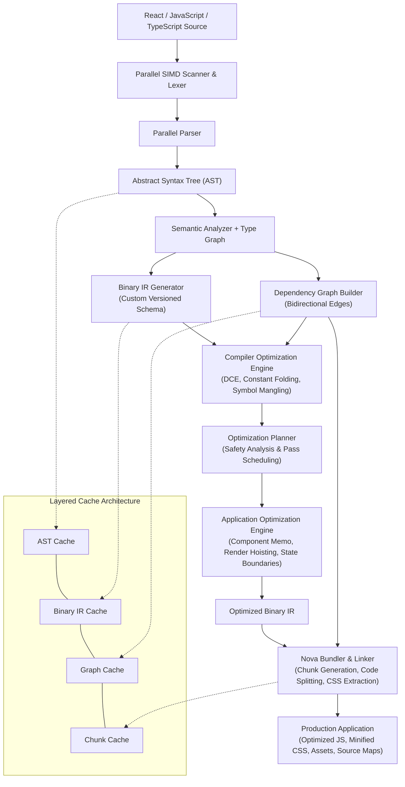

<p align="center">
  <h1 align="center">⚡ Nova</h1>
  <p align="center"><strong>A React-Compatible High-Performance Build Platform</strong></p>
  <p align="center"><em>Keep React. Rebuild the engine beneath it.</em></p>
</p>

<p align="center">
  <a href="https://github.com/Dineshkanna-FSDev/Nova_bundler/actions"></a>
  <a href="./LICENSE"></a>
  <a href="https://www.rust-lang.org/"></a>
  <a href="https://react.dev/"></a>
  <a href="./docs/"></a>
</p>

---

## 📌 Table of Contents

- [Project Status](#project-status)
- [Vision & Philosophy](#vision--philosophy)
- [Core Architecture](#core-architecture)
- [Key Subsystems](#key-subsystems)
- [Proposed Core Algorithm](#proposed-core-algorithm)
- [Repository Structure](#repository-structure)
- [Workspace Crates](#workspace-crates)
- [Technology Stack](#technology-stack)
- [Comprehensive Documentation](#comprehensive-documentation)
- [Quick Start](#quick-start)
- [Development Roadmap](#development-roadmap)
- [Performance & Benchmarking](#performance--benchmarking)
- [Research Team & Supervision](#research-team--supervision)
- [License](#license)

---

## 🔬 Project Status

> **Status:** Under Active Development ⚙️  
> Nova is currently in its architecture design, specification, and initial prototype implementation phase (Milestone 1). Core compiler data structures, Binary IR serialization, dependency graph algorithms, and optimization planning are being iteratively developed.

---

## 💡 Vision & Philosophy

Modern frontend applications rely on a fragmented stack of disconnected tools: transpilers, type checkers, tree-shakers, chunk linkers, and asset minimizers. Each tool reparses JavaScript from scratch, discarding valuable semantic knowledge at boundaries.

**Nova takes a compiler-first approach.**

Instead of treating compilation, dependency analysis, optimization, and bundling as separate processing stages, Nova introduces a shared **Binary Intermediate Representation (Binary IR)** that carries rich semantic information throughout the entire build lifecycle.

> **Our Goal:** Not to replace React, alter JSX syntax, or introduce another esoteric framework. Nova is designed to keep existing React code 100% compatible while radically transforming the performance, efficiency, and intelligence of the underlying engine.

```text
Traditional Pipeline:
React / TS ──> Parser ──> AST ──> Emit JS ──> Bundler ──> Re-parse AST ──> Bundle JS

Nova Unified Pipeline:
React / TS ──> Lexer/Parser ──> Semantic Analyzer ──> Binary IR ──> Optimization Engine ──> Bundler ──> Optimized JS
                                                           │                  │
                                                   (Shared In-Memory & On-Disk Caches)
```

---

## 🏛️ Core Architecture



---

## 🧩 Key Subsystems

| Subsystem | Role & Key Responsibilities |
|---|---|
| **`nova-parser`** | High-throughput SIMD tokenization and parallel AST parsing for TSX, JSX, TypeScript, and ESNext. |
| **`nova-ir`** | Canonical binary intermediate representation format preserving component semantics, JSX trees, prop structures, hooks, and static metadata. |
| **`nova-compiler`** | Semantic analysis, symbol resolution, lexical scope binding, and Binary IR lowering. |
| **`nova-graph`** | Directed module graph maintaining forward imports, reverse dependents, circular dependency detection, and change impact analysis. |
| **`nova-optimizer`** | Multi-tier optimization pipeline applying provably safe transformations (render tree hoisting, component auto-memoization, static constant folding). |
| **`nova-bundler`** | Binary-IR-native linker emitting optimized JavaScript chunks, runtime bootstrap, extracted CSS, and high-fidelity source maps. |
| **`nova-cache`** | High-performance content-addressable storage (BLAKE3) indexing ASTs, IR blobs, graph diffs, and chunk outputs. |
| **`nova-cli`** | Developer CLI command runner, configuration manager (`nova.config.ts`), and build diagnostics reporter. |

---

## ⚡ Proposed Core Algorithm

### **Binary-IR-Guided Incremental Optimization**

Nova avoids full re-evaluations through a deterministic 7-stage invalidation and optimization process:

1. **Fingerprint Source & Configuration**: Calculate cryptographic hashes (BLAKE3) of source files, environment variables, and `nova.config`.
2. **Reuse or Build AST / Binary IR**: Query the persistent cache for valid representations; re-tokenize only modified files.
3. **Update Dependency Graph**: Perform differential edge analysis to identify structural topology shifts (new imports, removed re-exports).
4. **Find Affected Modules**: Walk reverse dependency chains to compute the precise *Impact Boundary Set* $\mathcal{S}_{\text{affected}}$.
5. **Select Safe Optimization Passes**: Optimization Planner queries IR metadata to verify purity rules before scheduling transformations.
6. **Validate Optimized Binary IR**: Structural and semantic verification passes confirm bytecode invariants and JSX integrity.
7. **Bundle & Reuse Unchanged Chunks**: Retain existing chunk hashes; re-link and serialize only the invalidated runtime artifacts.

---

## 📁 Repository Structure

```text
Nova_bundler/
│
├── README.md                   # Project overview, architecture summary, and research status
├── LICENSE                     # MIT License
│
├── docs/                       # Comprehensive Architecture Specifications
│   ├── PROJECT_OVERVIEW.md     # Vision, academic background, and problem space
│   ├── ARCHITECTURE.md         # End-to-end system design and pipeline mechanics
│   ├── WORKING_FLOW.md         # Cold build, incremental build, and dev flow
│   ├── BINARY_IR.md            # Bytecode schema, memory layout, and IR spec
│   ├── DEPENDENCY_GRAPH.md     # DAG mechanics, reverse lookup, and invalidation
│   ├── OPTIMIZATION_ENGINE.md  # Compiler & Application-level optimization passes
│   ├── PROPOSED_ALGORITHM.md   # Mathematical specification of the 7-stage algorithm
│   ├── CACHE_DESIGN.md         # Tiered caching, fingerprinting, and eviction
│   ├── MODULE_DESIGN.md        # Crate interfaces, APIs, and boundary contracts
│   ├── IMPLEMENTATION_ROADMAP.md # Phased execution schedule and deliverables
│   └── BENCHMARKING.md         # Metrics, baseline comparisons (Vite/Webpack), fixtures
│
├── crates/                     # Planned Rust Engine Modules
│   ├── nova-cli/               # CLI commands and configuration loader
│   ├── nova-parser/            # SIMD lexer and AST parser
│   ├── nova-compiler/          # Semantic analyzer and IR generator
│   ├── nova-ir/                # Binary IR schema, encoder, and decoder
│   ├── nova-optimizer/         # Optimization planner and pass registry
│   ├── nova-graph/             # Directed dependency graph engine
│   ├── nova-bundler/           # Chunk generation and code linker
│   └── nova-cache/             # Content-addressable cache manager
│
├── examples/                   # Reference React Testbeds
│   └── react-demo/             # Interactive React 18+ counter and dashboard fixture
│
├── benchmarks/                 # Reproducible Benchmarking Suites
│
└── tests/                      # Integration and Fixture Tests
```

---

## 📦 Workspace Crates

| Crate | Version | Status | Description |
|---|---|---|---|
| [`nova-cli`](./crates/nova-cli) | `0.1.0-alpha.1` | 🟡 Active | Command-line interface and configuration parser |
| [`nova-parser`](./crates/nova-parser) | `0.1.0-alpha.1` | 🟡 Active | SIMD tokenization & parallel AST parsing |
| [`nova-compiler`](./crates/nova-compiler) | `0.1.0-alpha.1` | 🟡 Active | Semantic analysis & IR synthesis |
| [`nova-ir`](./crates/nova-ir) | `0.1.0-alpha.1` | 🟡 Active | Binary IR schema, memory structures, serialization |
| [`nova-optimizer`](./crates/nova-optimizer) | `0.1.0-alpha.1` | 🟡 Active | Compiler & Application optimization passes |
| [`nova-graph`](./crates/nova-graph) | `0.1.0-alpha.1` | 🟡 Active | Dependency graph DAG & reverse topological invalidation |
| [`nova-bundler`](./crates/nova-bundler) | `0.1.0-alpha.1` | 🟡 Active | Binary-IR-driven chunk emitter & JavaScript code generator |
| [`nova-cache`](./crates/nova-cache) | `0.1.0-alpha.1` | 🟡 Active | Multi-tier content-addressable cache storage |

---

## 🛠️ Technology Stack

| Layer | Technology | Details |
|---|---|---|
| **Core Platform** | [Rust](https://www.rust-lang.org/) (2021 Edition) | High-concurrency, memory safety, zero-cost abstractions |
| **Target Framework** | [React](https://react.dev/) 18+ / 19 | Standard JSX/TSX, React Hooks, Concurrent Mode |
| **Supported Inputs** | TS, TSX, JS, JSX, CSS, Assets | Modern ECMAScript (ES2015 - ESNext) |
| **Internal Representation** | Custom Binary IR | Memory-mapped zero-copy structured IR schema |
| **Graph Engine** | Directed Module Graph | Bidirectional reverse-index topological DAG |
| **Concurrency** | Rayon + SIMD Intrinsics | Multithreaded parsing, semantic analysis, and chunking |
| **Hashing Engine** | BLAKE3 | Cryptographic, ultra-fast content fingerprinting |
| **Evaluation Baseline** | Vite, Webpack, esbuild | Benchmarked on cold builds, incremental rebuilds, memory |

---

## 📚 Comprehensive Documentation

Explore the in-depth architectural and design specifications in the [`docs/`](./docs) directory:

- 📖 [**Project Overview**](./docs/PROJECT_OVERVIEW.md) — Motivation, academic background, and problem space.
- 🏗️ [**Architecture Specification**](./docs/ARCHITECTURE.md) — High-level architecture, module contracts, and data flow.
- 🔄 [**Working Flow**](./docs/WORKING_FLOW.md) — Build lifecycle, incremental analysis, and dev server mechanics.
- 💾 [**Binary IR Specification**](./docs/BINARY_IR.md) — Binary format, memory layout, opcode sets, and metadata flags.
- 🕸️ [**Dependency Graph**](./docs/DEPENDENCY_GRAPH.md) — Edge representations, cycle handling, and dirty-boundary propagation.
- 🚀 [**Optimization Engine**](./docs/OPTIMIZATION_ENGINE.md) — Render-tree hoisting, auto-memoization, and pass scheduling.
- 🧮 [**Proposed Algorithm**](./docs/PROPOSED_ALGORITHM.md) — Formal 7-stage algorithm, pseudocode, and mathematical formulation.
- 🗄️ [**Cache Design**](./docs/CACHE_DESIGN.md) — Multi-tier cache structure, BLAKE3 keys, and eviction strategies.
- 📦 [**Module Design**](./docs/MODULE_DESIGN.md) — Comprehensive breakdown of all 8 Rust engine crates.
- 🗺️ [**Implementation Roadmap**](./docs/IMPLEMENTATION_ROADMAP.md) — Milestone planning, active phases, and delivery timeline.
- 📊 [**Benchmarking Suite**](./docs/BENCHMARKING.md) — Methodology, metrics, target baselines, and test harnesses.

---

## 🚀 Getting Started & Architecture Exploration

Nova is currently in its active architecture, specification, and algorithm design phase.

1. **Architecture & Data Flow:** Review the end-to-end compiler pipeline and cache interactions in [`docs/ARCHITECTURE.md`](./docs/ARCHITECTURE.md).
2. **Binary IR Specification:** Inspect the memory layout, bytecode schema, and opcodes in [`docs/BINARY_IR.md`](./docs/BINARY_IR.md).
3. **Core Algorithm:** Study the formal 7-stage *Binary-IR-Guided Incremental Optimization* algorithm in [`docs/PROPOSED_ALGORITHM.md`](./docs/PROPOSED_ALGORITHM.md).
4. **Dependency Graph:** Understand bidirectional DAG edges and reverse invalidation in [`docs/DEPENDENCY_GRAPH.md`](./docs/DEPENDENCY_GRAPH.md).
5. **Roadmap & Phases:** Track engineering milestones in [`docs/IMPLEMENTATION_ROADMAP.md`](./docs/IMPLEMENTATION_ROADMAP.md).

---

## 🗺️ Development Roadmap

- [x] **Phase 1: Architecture & Foundation**
  - [x] High-level architectural specification (v3.0)
  - [x] Binary IR format definition and layout
  - [x] Workspace crate scaffolding
- [ ] **Phase 2: Semantic Analysis & IR Lowering**
  - [ ] SIMD tokenization & parser integration
  - [ ] JSX/TSX semantic symbol extraction
  - [ ] Binary IR serialization & deserialization validation
- [ ] **Phase 3: Dependency Graph & Invalidation Engine**
  - [ ] Bidirectional edge tracking & circular dependency resolution
  - [ ] Differential graph reconciliation
- [ ] **Phase 4: Optimization Engine & Pass Scheduling**
  - [ ] Compiler-level constant folding & DCE
  - [ ] Application-level component memoization & render tree hoisting
- [ ] **Phase 5: Bundler & Code Generator**
  - [ ] Binary-IR-driven chunk generation & code splitting
  - [ ] High-fidelity source map synthesis & minification
- [ ] **Phase 6: Benchmarking & Academic Evaluation**
  - [ ] Cold and incremental build benchmarks against Vite and esbuild
  - [ ] Runtime memory & render performance profiling

---

## 👥 Research Team & Supervision

Nova is being actively researched and developed at **SRM Institute of Science and Technology, Tiruchirappalli**:

- **Kirutiga G** — `RA2311008050003`
- **Dinesh Kanna R** — `RA23110080500010` ([@Dineshkanna-FSDev](https://github.com/Dineshkanna-FSDev))
- **Nithish M** — `RA23110080500033`

**Project Supervisor:**
- **Dr. Jubilant Kizhakkethottam** — Head of the Department, Department of Information Technology, SRM IST, Tiruchirappalli.

---

## 📄 License

This project is licensed under the [MIT License](./LICENSE).
