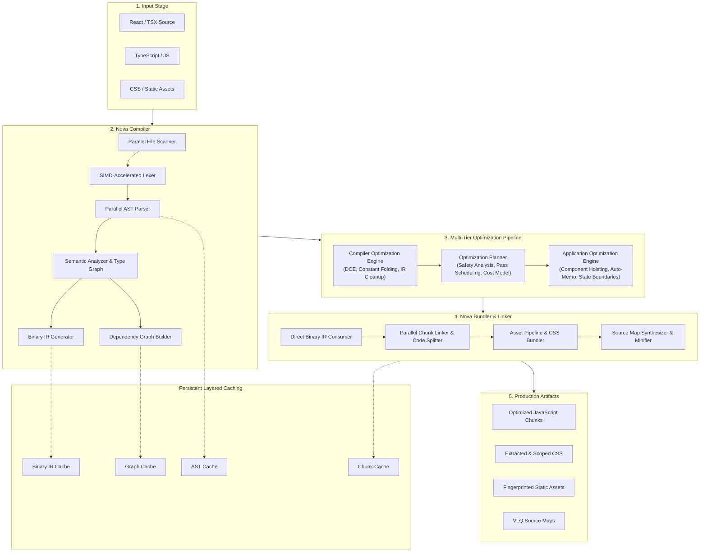

# Nova: System Architecture Specification

> **Specification Version:** 3.0  
> **Status:** Architecture Reference & Specification Document  
> **Target Platform:** React 18+ / React 19 / TypeScript 5+

---

## 1. High-Level Architecture Overview

Nova is structured as a unified compiler and bundling platform implemented in Rust. Unlike conventional bundlers that treat source transformations as isolated string-to-string or AST-to-AST steps, Nova organizes the entire build process around a shared **Binary Intermediate Representation (Binary IR)**.

---

## 2. Pipeline Subsystems in Detail

### 2.1. Ingestion & Parallel Lexing (`nova-parser`)
- **Parallel File Scanner:** Asynchronously scans project workspaces utilizing memory-mapped I/O (`mmap`), respecting `.gitignore` and `nova.config` exclude filters.
- **SIMD Lexer:** Utilizes vector intrinsics (AVX-2 / NEON) to fast-forward through whitespace, line breaks, identifiers, and string literals, yielding token streams at multi-gigabyte-per-second throughput.
- **Parallel AST Parser:** Distributes parsing tasks across Rayon worker threads. Each thread outputs an Abstract Syntax Tree representing module declarations, JSX syntax, and TypeScript type annotations.
- **Persistent AST Cache:** If a file's content hash matches an existing cache entry, the AST parse phase is bypassed entirely.

### 2.2. Semantic Analysis & Binary IR Generation (`nova-compiler`, `nova-ir`)
- **Semantic Analyzer & Type Graph:**
  - Performs lexical scoping analysis and symbol resolution.
  - Resolves local bindings, imported identifiers, and exported bindings.
  - Analyzes React component declarations, distinguishing function components from utility functions.
  - Tracks React hook usage (`useState`, `useReducer`, `useEffect`, `useCallback`, `useMemo`, `useRef`).
- **Binary IR Generator:**
  - Converts semantic AST information into a versioned, compact binary bytecode format (`.novair`).
  - Encodes symbol tables, component metadata, JSX render subtrees, static props, and source code spans.
- **Dependency Graph Generator (`nova-graph`):**
  - Extracts module import/export edges.
  - Constructs a bidirectional graph maintaining both forward dependencies and reverse dependents.

### 2.3. Compiler Optimization Engine (`nova-optimizer`)
Runs immediately after Binary IR generation at the module level:
- **Dead Code Elimination (DCE):** Eliminates unreachable control paths and unreferenced local functions.
- **Constant Folding & Propagation:** Pre-evaluates compile-time arithmetic, string operations, and static expressions.
- **Static Component Detection:** Identifies React components with invariant render outputs that take no dynamic props.
- **Symbol Optimization:** Minimizes and mangles local identifiers while preserving public export contracts.
- **Binary IR Cleanup & Validation:** Strips orphaned spans and validates IR integrity against the Binary IR schema.

### 2.4. Optimization Planner (`nova-optimizer`)
Serves as the decision-making brain before application-level transformations:
- **Safety Checker:** Verifies that candidate components satisfy the purity rules (idempotent render, absence of side-effects outside hooks).
- **Pass Scheduler:** Determines optimal ordering of cross-module transformations.
- **Cost Analyzer:** Evaluates trade-offs (e.g., whether inlining a small component increases bundle size beyond the cache threshold).

### 2.5. Application Optimization Engine (`nova-optimizer`)
The core innovation of Nova: optimizing the **application semantics** rather than just code syntax:
- **Render Tree Hoisting:** Hoists invariant JSX subtrees to module scope so they are created once and reused across renders.
- **Automatic Component Memoization:** Inserts safe equivalence checks and memoization boundaries without requiring developers to manually annotate every component with `React.memo`.
- **State Ownership Optimization:** Identifies tightly coupled state variables to avoid unnecessary parent re-renders.
- **Route-Based Code Splitting:** Analyzes route hierarchies to synthesize lazy-loaded chunk boundaries.
- **CSS Extraction & Deduplication:** Extracts CSS Modules and utility styles at compile time, eliminating CSS-in-JS runtime overhead.
- **Memory Allocation Hoisting:** Hoists array/object literals passed as props in JSX to eliminate garbage collector churn.

### 2.6. Nova Bundler & Linker (`nova-bundler`)
- **Direct Binary IR Ingestion:** Unlike Webpack or Rollup, the Nova Bundler directly consumes the optimized Binary IR blobs without reparsing emitted JavaScript.
- **Parallel Chunk Generation:** Partitions the module graph into entry chunks, vendor chunks, and dynamic chunks.
- **Code Generation & Source Maps:** Serializes the final optimized Binary IR directly into high-performance JavaScript conforming to ES2020+ standards, همراه with precise VLQ-encoded source maps.

---

## 3. Layered Cache Architecture

Nova eliminates redundant work across cold and incremental builds via a 4-tier persistent cache:

| Cache Layer | Stored Artifact | Validation Key | Benefit |
|---|---|---|---|
| **AST Cache** | Serialized AST data | `BLAKE3(File Content + Parser Version)` | Skips lexing and AST construction |
| **Binary IR Cache** | Pre-compiled Binary IR (`.novair`) | `BLAKE3(AST Hash + Compiler Config)` | Skips semantic analysis and type checking |
| **Dependency Graph Cache** | Module edge topology & symbol maps | `BLAKE3(Workspace Manifest + All IR Keys)` | Skips topological sorting and cycle detection |
| **Chunk Cache** | Final linked JS/CSS bundles | `BLAKE3(Chunk IR Hashes + Bundler Config)` | Skips bundle emission and minification |

---

## 4. Concurrency & Performance Model

1. **Lock-Free Read Operations:** Shared compiler data structures use `Arc` and atomic references to prevent thread contention.
2. **Work-Stealing Task Pool:** Rayon thread pool dynamically balances parsing, IR generation, and chunk serialization across available CPU cores.
3. **Zero-Copy Bytecode:** Binary IR uses 64-bit alignment and memory-mappable serialization, allowing the bundler to read IR buffers without full deserialization passes.
4. **SIMD Acceleration:** Critical string scanning, whitespace trimming, and identifier matching use SIMD vector lanes.

---

## 5. Security & Boundary Architecture

- **Sandbox File Access:** The file scanner strictly respects project boundaries and denies traversing symbolic links outside the project root.
- **Deterministic Builds:** Cache keys incorporate compiler version, configuration flags, and file content hashes, ensuring byte-for-byte reproducibility.
- **Graceful Error Recovery:** Syntax and semantic errors are reported using Rust-based diagnostics with colorized terminal spans, allowing parsing to continue across other files to report all errors in a single run.
