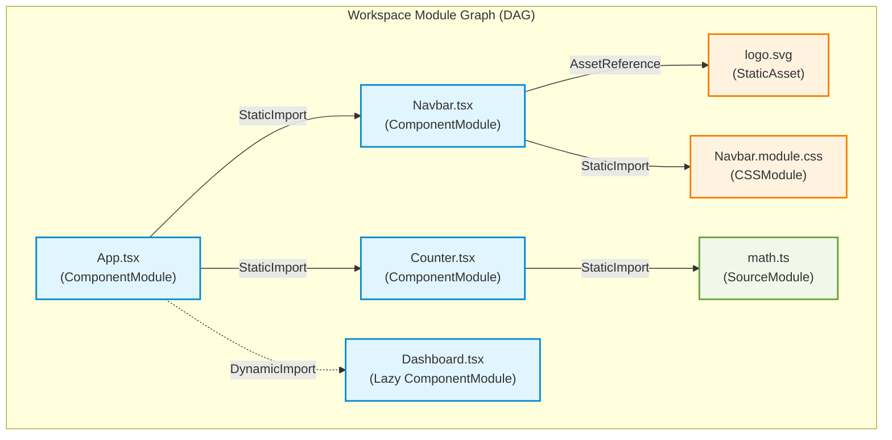
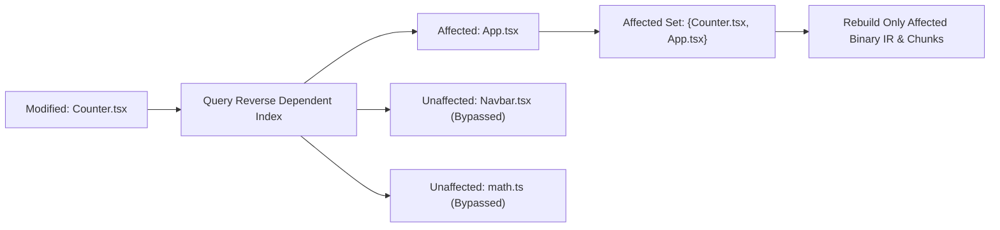

# Nova: Dependency Graph Engine

> **Specification Version:** 3.0  
> **Status:** Architecture Reference & Specification Document  
> **Crate:** `crates/nova-graph`

---

## 1. Overview

The **Dependency Graph** is the foundational topological data structure in Nova. It records all relationships between modules, components, stylesheets, and assets across the entire application workspace.

Unlike traditional bundlers whose module graphs are unidirectionally optimized only for output emission, Nova's graph engine maintains **bidirectional edge indices** (forward imports and reverse dependents). This bidirectional structure enables **instant change impact propagation** and surgical cache invalidation during incremental development.

---

## 2. Graph Topography & Edge Model



---

## 3. Node Classifications

Every entity in the graph is assigned a unique 64-bit `ModuleId`:

| Node Kind | Description | Attributes Tracked |
|---|---|---|
| `SourceModule` | Standard JS/TS utility or script file | Exports, imports, side-effect flag, content hash |
| `ComponentModule` | File containing one or more React components | Component metadata, hook list, render tree root |
| `CSSModule` | Localized CSS stylesheet | Scoped class mappings, imported fonts/images |
| `StaticAsset` | Non-code binary resource (SVG, PNG, WOFF2) | Mime type, byte size, file hash, emission path |
| `VirtualEntry` | Synthetic entry point synthesized by Nova | Chunk initialization code, HMR runtime scripts |

---

## 4. Edge Classifications

Edges are directed from consumer to provider, but automatically registered in both the forward adjacency table and the reverse dependency index:

```rust
pub enum DependencyEdgeKind {
    /// Standard ESM import: import { a } from './b'
    StaticImport {
        imported_symbols: Vec<SymbolId>,
    },
    /// Asynchronous dynamic import: import('./c')
    DynamicImport {
        chunk_name_hint: Option<String>,
    },
    /// TypeScript type import: import type { T } from './d'
    /// (Elided before bundling, tracked for type invalidation)
    TypeOnlyImport,
    /// Asset reference: import logo from './logo.svg'
    AssetReference {
        asset_kind: AssetKind,
    },
    /// Transparent re-export: export * from './e'
    ReExport {
        aliased_symbols: Vec<(SymbolId, SymbolId)>,
    },
}
```

---

## 5. Circular Dependency Handling

Circular dependencies are common in large frontend codebases (e.g., Component A imports Component B, which imports Component A). Unhandled cycles cause infinite loops in naive topological traversals and bundle linking.

### Tarjan's Strongly Connected Components (SCC)
Nova runs **Tarjan's SCC Algorithm** during graph reconciliation:
1. Detects cycles in $O(V + E)$ linear time.
2. Groups cyclic nodes into a single **Super-Node** (Strongly Connected Component).
3. Evaluates initialization order within the SCC to ensure exported bindings are hoisted or declared before invocation.
4. Generates compilation warnings if an uninitialized circular binding access is detected at runtime.

---

## 6. Incremental Invalidation & Impact Analysis

When a source file is modified, Nova avoids regenerating the entire graph by executing a **differential topological walk**:



### Invalidation Algorithm

Given a modified node $m \in \mathcal{V}$:
1. **Content Comparison:** If $\text{BLAKE3}(\text{Content}(m)) == \text{CachedHash}(m)$, abort invalidation.
2. **Local Re-Analysis:** Re-parse $m$ and compute updated outgoing edges $\mathcal{E}'(m)$.
3. **Topology Delta Check:**
   - If $\mathcal{E}'(m) == \mathcal{E}(m)$ (only implementation changed, imports did not), the graph structure is static.
   - If $\mathcal{E}'(m) \neq \mathcal{E}(m)$, update forward and reverse adjacency tables.
4. **Reverse Reachability Traversal:**
   Compute the transitive closure of dependents that consume changed exports:
   $$\mathcal{S}_{\text{affected}} = \{ v \in \mathcal{V} \mid v \rightsquigarrow m \text{ and depends on modified exports of } m \}$$
5. **Boundary Containment:**
   If a dependent component has an established memoization or dynamic-chunk boundary, the invalidation propagation stops at that boundary, preventing unnecessary full-app rebuilds.

---

## 7. Reachability & Dead Branch Pruning (Tree Shaking)

Nova performs live-symbol reachability analysis starting from entry points:

1. **Mark Phase:** Starting from root entry points, mark all reachable modules and exported symbols.
2. **Sweep Phase:**
   - Modules with zero incoming edges and no global side-effects are pruned from the chunk schedule.
   - Specific exported functions that are never imported by any reachable module are removed from the module's Binary IR symbol table.
3. **Asset Pruning:** Images or stylesheets never referenced by any live module are omitted from the production `/dist` directory.

---

## 8. Graph Persistence & Delta Caching

The dependency graph is serialized to `.nova/cache/graph.bin` using a compact adjacency array:
- Fast startup: deserialized in < 5ms for a 10,000-module application.
- Delta caching: Only modified edges and node attributes are rewritten to disk on incremental rebuilds.
