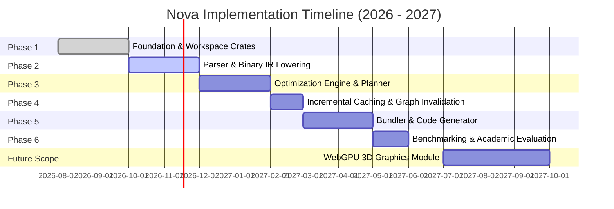

# Nova: Implementation Roadmap & Execution Schedule

> **Specification Version:** 3.0  
> **Status:** Active Execution Schedule  
> **Current Active Phase:** Phase 1 — Foundation & Core Architecture

---

## 1. Roadmap Overview

The Nova development roadmap is organized into six core implementation phases followed by an experimental future graphics extension.

---

## 2. Phase-by-Phase Execution Details

### Phase 1: Foundation & Architecture (Current Status: In Progress / Complete)
- [x] High-level architectural specifications (v3.0).
- [x] Cargo multi-crate workspace setup (8 dedicated crates).
- [x] Binary IR format definition, header layout, and opcode specifications.
- [x] React compatibility baseline and sample fixtures (`examples/react-demo`).
- [x] Formal formulation of the 7-stage *Binary-IR-Guided Incremental Optimization* algorithm.

### Phase 2: Parser & Binary IR Lowering (Target: Oct 2026 – Dec 2026)
- [ ] Integrate high-performance parser for TypeScript, JSX, and TSX syntax.
- [ ] Implement SIMD tokenization for fast-forwarding whitespace, identifiers, and string literals.
- [ ] Build the lexical scope analyzer and symbol resolution table in `nova-compiler`.
- [ ] Implement JSX component metadata extraction (detecting function components, props, and hooks).
- [ ] Implement zero-copy Binary IR encoder and decoder in `nova-ir`.
- [ ] Validate Binary IR roundtrip fidelity (AST $\to$ IR $\to$ AST equivalence).

### Phase 3: Optimization Engine & Planner (Target: Dec 2026 – Feb 2027)
- [ ] Implement the **Optimization Planner** (Safety Checker, Pass Scheduler, Cost Model).
- [ ] Implement Tier 1 Compiler passes:
  - Dead Code Elimination (DCE).
  - Constant Folding and algebraic reduction.
  - Static component detection.
- [ ] Implement Tier 2 Application passes:
  - Render tree hoisting for invariant JSX subtrees.
  - Automatic component memoization boundaries.
  - Memory allocation hoisting for prop object/array literals.
- [ ] Enforce strict Binary IR bytecode validation post-transformation.

### Phase 4: Incremental Build System (Target: Feb 2027 – Mar 2027)
- [ ] Construct the bidirectional dependency graph (`nova-graph`).
- [ ] Implement Tarjan's SCC algorithm for cycle resolution.
- [ ] Implement BLAKE3 content fingerprinting across files and environment configs (`nova-cache`).
- [ ] Implement reverse topological impact analysis ($\mathcal{S}_{\text{affected}}$ computation).
- [ ] Implement multi-tier caching (RAM hot pool and persistent disk cache).

### Phase 5: Bundler & Code Generator (Target: Mar 2027 – May 2027)
- [ ] Implement chunk partitioning algorithm (entry chunks, vendor chunks, async chunks).
- [ ] Implement JavaScript code emitter directly from optimized Binary IR.
- [ ] Integrate tree-shaking and dead-branch pruning.
- [ ] Implement CSS extraction, module class scoping, and asset deduplication.
- [ ] Synthesize high-fidelity VLQ-encoded source maps (`.map`).

### Phase 6: Benchmarking & Academic Evaluation (Target: May 2027 – Jun 2027)
- [ ] Cold build benchmark comparisons against Vite, Webpack, and esbuild.
- [ ] Incremental rebuild benchmark suite measuring sub-15ms rebuild targets.
- [ ] Production output bundle size and compression measurements (Gzip / Brotli).
- [ ] Browser runtime profiling (First Contentful Paint, Time to Interactive, DOM reconciliation cost).
- [ ] Final Review presentation and academic research publication.

---

## 3. Future Scope: WebGPU 3D Graphics Module

Following the completion of the core build platform, an optional browser-native 3D rendering module will be investigated:
- **Focus:** Direct WebGPU pipeline integration for React applications without heavy Three.js runtime overhead.
- **Implementation:** Rust-compiled WebAssembly (Wasm) compute shaders and scene graph manipulation.
- **Status:** Explicitly segregated from the core compiler and bundler roadmap.

---

## 4. Risk Analysis & Mitigation Matrix

| Potential Risk | Severity | Mitigation Strategy |
|---|---|---|
| Non-standard JSX edge cases breaking parser | Medium | Utilize battle-tested parser components and fuzz-test against top 500 popular React npm packages. |
| Over-aggressive optimization breaking React component state | High | Strict Optimization Planner safety rules; optimizations disabled unless purity is mathematically proven. |
| Invalidation leaks leading to stale cache hits | High | Cryptographic BLAKE3 fingerprints combining source bytes, config, and engine version into a single key. |
| Circular dependency infinite loops in bundler | Medium | Automatic grouping of circular modules into strongly connected super-nodes via Tarjan's SCC algorithm. |
