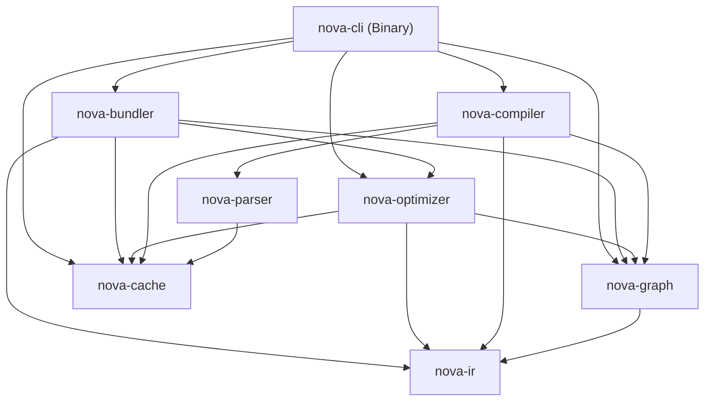

# Nova: Modular Architecture & Crate Specifications

> **Specification Version:** 3.0  
> **Status:** Architecture Reference & Specification Document  
> **Workspace:** Cargo Multi-Crate Workspace (8 Crates)

---

## 1. Crate Dependency Topology

Nova's architecture is strictly layered to prevent circular dependencies between crates and enable fine-grained compilation caching.



---

## 2. Detailed Crate Specifications

### 2.1. `nova-cli`
- **Type:** Binary Crate (`crates/nova-cli`)
- **Primary Role:** Serves as the command-line interface, user configuration ingestor, and orchestration harness.
- **Key Responsibilities:**
  - CLI argument parsing via `clap` (`nova build`, `nova dev`, `nova check`, `nova clean`).
  - Discovers and loads `nova.config.ts` or `nova.config.json`.
  - Manages file watcher events (`notify` crate) for hot module reload in dev mode.
  - Formats compiler diagnostics and outputs build performance telemetry tables.

### 2.2. `nova-parser`
- **Type:** Library Crate (`crates/nova-parser`)
- **Primary Role:** High-throughput tokenization and syntax parsing.
- **Key Responsibilities:**
  - SIMD-accelerated lexing of TypeScript, TSX, JavaScript, and JSX source files.
  - Multithreaded AST generation using Rayon worker threads.
  - Preserves precise source code spans (byte offsets, line numbers, column positions) for source map correlation.
  - Emits syntax diagnostics with localized contextual code snippets.

### 2.3. `nova-compiler`
- **Type:** Library Crate (`crates/nova-compiler`)
- **Primary Role:** Semantic analysis and Binary IR synthesis.
- **Key Responsibilities:**
  - Builds lexical scope hierarchies and variable bindings.
  - Resolves module import and export bindings against project paths.
  - Analyzes React component semantics: detects functional components, hooks, prop interfaces, and JSX returns.
  - Lowers AST nodes into canonical `BinaryIrModule` byte structures.

### 2.4. `nova-ir`
- **Type:** Library Crate (`crates/nova-ir`)
- **Primary Role:** The foundational specification, memory representation, and serialization schema for Nova's Binary IR.
- **Key Responsibilities:**
  - Defines binary file header format, section headers, and bytecode opcodes.
  - Zero-copy encoder and decoder for `.novair` files.
  - String interning pool and Symbol ID allocation.
  - Bytecode integrity and schema validation logic.

### 2.5. `nova-optimizer`
- **Type:** Library Crate (`crates/nova-optimizer`)
- **Primary Role:** Two-tier optimization engine and pass scheduler.
- **Key Responsibilities:**
  - **Compiler Passes:** Dead code elimination, constant folding, static component detection.
  - **Optimization Planner:** Safety verifier, hook purity checker, and pass scheduler.
  - **Application Passes:** Static render tree hoisting, automatic component memoization, prop literal allocation hoisting, route splitting.

### 2.6. `nova-graph`
- **Type:** Library Crate (`crates/nova-graph`)
- **Primary Role:** Directed module dependency graph and topological analysis.
- **Key Responsibilities:**
  - Maintains bidirectional graph edges (forward imports and reverse dependents).
  - Cycle detection and Tarjan's Strongly Connected Component (SCC) resolution.
  - Topological sorting for correct execution and evaluation ordering.
  - Differential change impact analysis ($\mathcal{S}_{\text{affected}}$ calculation).

### 2.7. `nova-bundler`
- **Type:** Library Crate (`crates/nova-bundler`)
- **Primary Role:** Binary IR linker, code generator, and asset emitter.
- **Key Responsibilities:**
  - Consumes optimized Binary IR directly without re-parsing emitted JavaScript.
  - Graph-based chunk partitioning (entry chunks, vendor chunks, async chunks).
  - Emits standards-compliant ES2020+ JavaScript and scoped atomic CSS.
  - High-fidelity VLQ-encoded source map generation.

### 2.8. `nova-cache`
- **Type:** Library Crate (`crates/nova-cache`)
- **Primary Role:** Content-addressable persistent and in-memory cache manager.
- **Key Responsibilities:**
  - Cryptographic content fingerprinting using BLAKE3.
  - Disk storage management for ASTs, Binary IR blobs, graph state, and final chunks.
  - LRU cache eviction and disk quota enforcement.
  - Memory-mapped file I/O for instantaneous artifact deserialization.

---

## 3. Public Crate Interfaces & Contracts

Every crate exposes clean, strongly-typed public APIs. For example, between `nova-compiler` and `nova-bundler`:

```rust
// Contract between Compiler and Optimizer/Bundler in nova-ir
pub trait IrConsumer {
    fn consume_module(&mut self, module: &BinaryIrModule) -> Result<(), BundlerError>;
    fn link_chunks(&mut self, graph: &DependencyGraph) -> Result<ChunkManifest, BundlerError>;
}
```
