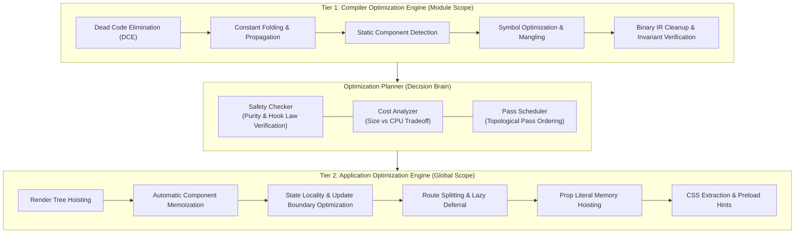

# Nova: Optimization Engine & Pass Architecture

> **Specification Version:** 3.0  
> **Status:** Architecture Reference & Specification Document  
> **Crate:** `crates/nova-optimizer`

---

## 1. Overview & Core Philosophy

Traditional bundlers optimize **JavaScript code syntax**: they shorten variable names, inline trivial literals, and remove unused functions. However, they lack semantic insight into what the code actually represents: **a React application**.

**Nova introduces a Two-Tier Optimization Architecture:**
1. **Tier 1: Compiler Optimization Engine** (Module-level syntactic and algebraic optimizations).
2. **Tier 2: Application Optimization Engine** (Application-level React component, render-tree, and state optimizations).

Every optimization in Nova is strictly governed by the **Optimization Planner**, ensuring transformations are applied only when correctness can be mathematically proven.



---

## 2. Tier 1: Compiler Optimization Engine

Tier 1 executes on individual `BinaryIrModule` units during or immediately following semantic analysis.

### 2.1. Dead Code Elimination (DCE)
- Identifies unreachable branch statements (`if (false) { ... }`, dead ternary arms, unreferenced block statements).
- Prunes unreferenced local variables and inner functions that do not escape module scope.

### 2.2. Constant Folding & Propagation
- Pre-computes compile-time mathematical expressions, template string concatenations, and boolean logic:
  ```tsx
  // Input
  const SECONDS_PER_DAY = 24 * 60 * 60;
  const BANNER = "Nova" + " v" + "3.0";

  // Transformed in Binary IR
  const SECONDS_PER_DAY = 86400;
  const BANNER = "Nova v3.0";
  ```

### 2.3. Static Component Detection
- Analyzes React function components to determine if their return JSX is invariant and independent of props, context, or hooks.
- Static components are tagged with `FLAG_STATIC_COMPONENT`, enabling Tier 2 to eliminate their re-render overhead.

### 2.4. Symbol Optimization
- Minifies internal variable and parameter names within local scopes while strictly preserving exported identifiers and public module interfaces.

---

## 3. The Optimization Planner

Before any application-level transformation is applied, the **Optimization Planner** verifies the candidate against three evaluation criteria:

### 3.1. Safety Checker (Soundness Verification)
An optimization pass is scheduled **only** if the target satisfies the Safety Conditions:
1. **Render Idempotence:** The component body must be a pure function of its props and state (no mutating external objects or reading mutable globals during render).
2. **Hook Integrity:** Hook call order must remain strictly invariant across renders.
3. **No Hidden Side Effects:** Expressions hoisted out of components must not invoke arbitrary functions that could trigger side effects at module load time.

### 3.2. Cost Analyzer
Prevents counter-productive optimizations. For example:
- **Inlining Cost:** Inlining a shared component into multiple call sites is permitted only if the total byte increase is below the threshold and does not degrade cache locality.
- **Memoization Overhead:** Components with trivial shallow renders (e.g., `<button>{label}</button>`) are **not** memoized because the cost of prop comparison exceeds the cost of re-rendering.

### 3.3. Pass Scheduler
Orders passes so that transformations feed into one another (e.g., Constant Folding runs before Dead Branch Elimination, which runs before Render Tree Hoisting).

---

## 4. Tier 2: Application Optimization Engine

Tier 2 operates on the connected Binary IR graph across module boundaries.

### 4.1. Render Tree Hoisting
When a component contains static JSX elements (such as SVG icons, headers, navigation chrome, or invariant sub-trees), creating new virtual DOM objects on every render wastes CPU and triggers garbage collection.
- Nova extracts the invariant JSX subtree and hoists it to a constant in module scope:
  ```tsx
  // Source Code
  function Header({ user }: { user: string }) {
    return (
      <header>
        <div className="logo"><svg>...</svg><span>Nova</span></div>
        <p>Welcome, {user}!</p>
      </header>
    );
  }

  // Optimized Output (Concept)
  const _hoisted_logo = <div className="logo"><svg>...</svg><span>Nova</span></div>;

  function Header({ user }) {
    return (
      <header>
        {_hoisted_logo}
        <p>Welcome, {user}!</p>
      </header>
    );
  }
  ```

### 4.2. Automatic Component Memoization
Manually adding `React.memo` across thousands of components is error-prone.
- The Optimizer inspects component prop structures. If all props are primitive or have proven compile-time stability, Nova automatically wraps the component export in an optimized memoization boundary.

### 4.3. Prop Literal Memory Allocation Hoisting
Inline object and array literals passed to JSX props (e.g., `style={{ margin: 10 }}`) force new object allocations on every render, defeating downstream memoization.
- Invariant prop literals are hoisted to module scope, preserving object reference equality across renders:
  ```tsx
  // Source: <Widget style={{ margin: 10 }} config={['a', 'b']} />
  // Hoisted:
  const _style_0 = { margin: 10 };
  const _config_0 = ['a', 'b'];
  // Render: <Widget style={_style_0} config={_config_0} />
  ```

### 4.4. Route Splitting & Dynamic Deferral
- Detects top-level route definitions (e.g., React Router, TanStack Router) and automatically synthesizes `React.lazy` and dynamic `import()` chunk boundaries, eliminating massive initial JS payloads.

### 4.5. CSS Extraction & Scope Deduplication
- Strips static CSS classes from CSS Modules at build time.
- Emits atomic, deduped CSS stylesheets directly to `/dist/assets/`, eliminating client-side CSS-in-JS style injection cost.

---

## 5. Correctness Guarantees

Every optimization in Nova conforms to the **Preservation of Semantics Theorem**:

$$\forall \text{ valid React State } \mathcal{S}, \quad \text{Render}(\mathcal{P}_{\text{optimized}}, \mathcal{S}) \cong \text{Render}(\mathcal{P}_{\text{original}}, \mathcal{S})$$

If an optimization cannot be formally proven safe, Nova strictly falls back to standard compilation, guaranteeing that existing React code never breaks.
