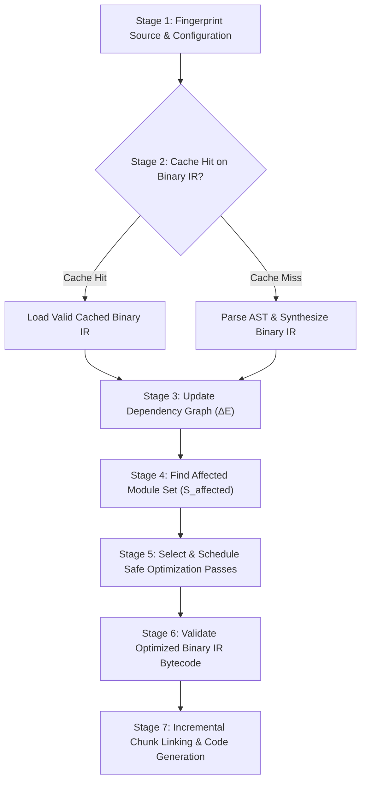

# Nova: Proposed Core Algorithm Specification

> **Algorithm Name:** Binary-IR-Guided Incremental Optimization  
> **Specification Version:** 3.0  
> **Status:** Academic Specification & Algorithm Standard  
> **Primary Authors:** Dinesh Kanna R, Kirutiga G, Nithish M  
> **Supervisor:** Dr. Jubilant Kizhakkethottam (SRM IST, Tiruchirappalli)

---

## 1. Abstract & Mathematical Formulation

Let the application workspace be represented as a tuple:

$$\mathcal{W} = (\mathcal{M}, \mathcal{C}, \mathcal{E}_{\text{env}})$$

where:
- $\mathcal{M} = \{m_1, m_2, \dots, m_n\}$ is the set of all source modules (TSX, JSX, TS, JS, CSS, Assets).
- $\mathcal{C}$ is the project configuration (`nova.config.ts`, `tsconfig.json`).
- $\mathcal{E}_{\text{env}}$ is the compilation environment (Node runtime, Rust target, Nova engine version).

Let $\mathcal{G} = (\mathcal{V}, \mathcal{E})$ be the directed module dependency graph, where:
- $\mathcal{V} = \mathcal{M}$ is the set of module vertices.
- $\mathcal{E} \subseteq \mathcal{V} \times \mathcal{V} \times \mathcal{T}_{\text{edge}}$ is the set of directed edges annotated with dependency types $\mathcal{T}_{\text{edge}}$ (Static, Dynamic, Asset, Type).

Let $\mathcal{K} = (\mathcal{K}_{\text{ast}}, \mathcal{K}_{\text{ir}}, \mathcal{K}_{\text{graph}}, \mathcal{K}_{\text{chunk}})$ be the persistent multi-tier cache store.

The objective of the **Binary-IR-Guided Incremental Optimization Algorithm** is to synthesize the target distribution $\mathcal{D} = \{\mathcal{J}_{\text{js}}, \mathcal{S}_{\text{css}}, \mathcal{A}_{\text{assets}}, \mathcal{M}_{\text{maps}}\}$ while minimizing the computational cost:

$$\min_{\mathcal{W} \to \mathcal{D}} \left( \sum_{m \in \mathcal{M}} \text{Cost}(m) \right) \quad \text{subject to} \quad \text{BehavioralEquivalence}(\mathcal{D}, \mathcal{D}_{\text{cold}})$$

---

## 2. The 7-Stage Algorithm

---

### Stage 1: Fingerprint Source & Configuration

For each module $m \in \mathcal{M}$, compute its content hash using the cryptographic BLAKE3 primitive:

$$\mathcal{H}_{\text{source}}(m) = \text{BLAKE3}(\text{ContentBytes}(m))$$

Compute the master configuration fingerprint:

$$\mathcal{H}_{\text{config}} = \text{BLAKE3}(\mathcal{C} \parallel \mathcal{E}_{\text{env}})$$

The composite cache key for module $m$ is:

$$\mathcal{K}_{\text{key}}(m) = \text{BLAKE3}(\mathcal{H}_{\text{source}}(m) \parallel \mathcal{H}_{\text{config}})$$

---

### Stage 2: Reuse or Build AST / Binary IR

For each module $m \in \mathcal{M}$:
1. Query $\mathcal{K}_{\text{ir}}$ with $\mathcal{K}_{\text{key}}(m)$.
2. If hit:
   $$\text{IR}(m) \leftarrow \text{Deserialize}(\mathcal{K}_{\text{ir}}[\mathcal{K}_{\text{key}}(m)])$$
3. If miss:
   - Tokenize via SIMD lexer: $\mathcal{T}(m) \leftarrow \text{Lex}(m)$.
   - Parse into AST: $\mathcal{A}(m) \leftarrow \text{Parse}(\mathcal{T}(m))$.
   - Perform semantic analysis: $\mathcal{S}(m) \leftarrow \text{AnalyzeSemantics}(\mathcal{A}(m))$.
   - Generate Binary IR: $\text{IR}(m) \leftarrow \text{EmitBinaryIR}(\mathcal{S}(m))$.
   - Store into cache: $\mathcal{K}_{\text{ir}}[\mathcal{K}_{\text{key}}(m)] \leftarrow \text{Serialize}(\text{IR}(m))$.

---

### Stage 3: Update Dependency Graph

1. Extract outgoing dependency edges $\mathcal{E}'(m)$ directly from $\text{IR}(m)$.
2. Compute edge differential:
   $$\Delta \mathcal{E}(m) = \mathcal{E}'(m) \setminus \mathcal{E}(m)$$
3. Update forward and reverse adjacency tables in $\mathcal{G}$.
4. Run Tarjan's SCC algorithm on $\mathcal{G}$ to detect and group any new cyclic components.

---

### Stage 4: Find Affected Modules (Impact Boundary Analysis)

Identify the set of modified modules:
$$\mathcal{M}_{\text{dirty}} = \{m \in \mathcal{M} \mid \mathcal{K}_{\text{key}}(m) \text{ was a cache miss or has } \Delta \mathcal{E}(m) \neq \emptyset\}$$

If $\mathcal{M}_{\text{dirty}} = \emptyset$, terminate early (0 ms rebuild).

Otherwise, compute the **Impact Boundary Set** $\mathcal{S}_{\text{affected}}$ using reverse topological reachability:

$$\mathcal{S}_{\text{affected}} = \mathcal{M}_{\text{dirty}} \cup \left\{ u \in \mathcal{V} \;\middle|\; \exists v \in \mathcal{M}_{\text{dirty}} \text{ such that } u \rightsquigarrow v \land \text{ConsumesChangedExports}(u, v) \right\}$$

---

### Stage 5: Select Safe Optimization Passes

The Optimization Planner evaluates every module $u \in \mathcal{S}_{\text{affected}}$:
1. Verify safety invariants:
   $$\text{IsPure}(u) \land \text{HooksSound}(u) \implies \text{EligibleForAppOpt}(u) = \text{true}$$
2. Schedule pipeline passes:
   - Module DCE
   - Constant Folding
   - Render Subtree Hoisting
   - Auto-Memoization wrapper insertion

---

### Stage 6: Validate Optimized Binary IR

Run strict bytecode validation on the transformed IR:
1. Verify section offset boundaries and 64-bit alignment.
2. Confirm all symbol references resolve within the interned string pool.
3. Assert that React hook call sequences remain deterministic and unbroken.

---

### Stage 7: Bundle & Reuse Unchanged Chunks

1. Map $\mathcal{G}$ into chunk partitions $\mathcal{P} = \{c_1, c_2, \dots, c_k\}$.
2. For each chunk $c_i$:
   - If $\mathcal{V}(c_i) \cap \mathcal{S}_{\text{affected}} = \emptyset$:
     $$\text{Reuse cached chunk: } \mathcal{J}_{\text{js}}[c_i] \leftarrow \mathcal{K}_{\text{chunk}}[c_i]$$
   - Else:
     $$\text{Re-link and emit chunk: } \mathcal{J}_{\text{js}}[c_i] \leftarrow \text{LinkChunk}(\mathcal{V}(c_i))$$
     $$\mathcal{K}_{\text{chunk}}[c_i] \leftarrow \mathcal{J}_{\text{js}}[c_i]$$
3. Emit output bundle files and generate source maps.

---

## 3. Algorithmic Complexity

| Execution Mode | Stage 1 - 2 (IR Generation) | Stage 3 - 4 (Graph Analysis) | Stage 5 - 6 (Optimization) | Stage 7 (Linking) | Overall Latency |
|---|---|---|---|---|---|
| **Cold Build** | $\mathcal{O}(|\mathcal{M}| \cdot L)$ | $\mathcal{O}(|\mathcal{V}| + |\mathcal{E}|)$ | $\mathcal{O}(|\mathcal{M}|)$ | $\mathcal{O}(|\mathcal{V}|)$ | Linear with project size |
| **Incremental Rebuild** | $\mathcal{O}(|\mathcal{M}_{\text{dirty}}| \cdot L)$ | $\mathcal{O}(|\mathcal{S}_{\text{affected}}| + |\mathcal{E}_{\text{dirty}}|)$ | $\mathcal{O}(|\mathcal{S}_{\text{affected}}|)$ | $\mathcal{O}(|\text{Chunks}_{\text{affected}}|)$ | **Sub-15ms (constant scale)** |

*(Where $L$ is average source file length).*
